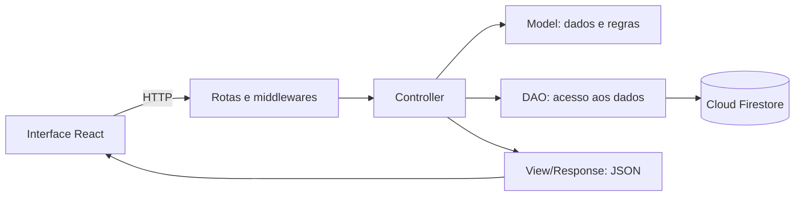

# DreamBuild PC

**Loja acadêmica de hardware e montagem de computadores**, desenvolvida por **Breno Dantas e Kaio Marques** para a disciplina de **Programação para Web Avançada**.

O DreamBuild reúne a escolha de peças, a verificação de compatibilidade e a experiência de compra em um mesmo site. A proposta é ajudar o usuário a entender os componentes de um computador, montar uma configuração e comparar alternativas antes de concluir uma compra simulada.

**[Acessar o site](https://dreambuild-pc.vercel.app/)** · **[Documentação da API](https://dreambuild-pc.vercel.app/api-docs/)** · **[Repositório](https://github.com/CPUNOF/dreambuild-pc)**

> Projeto com finalidade acadêmica. Compras, pagamentos, fretes e entregas são simulados: não há cobrança nem envio de produtos reais.

## O que o usuário encontra no site

### Catálogo e experiência de compra

A vitrine reúne 317 componentes, organizados em processadores, placas de vídeo, placas-mãe, memórias, armazenamento, fontes, gabinetes e refrigeração. A busca apresenta sugestões enquanto o usuário digita. Cada produto tem sua própria página com fotos, especificações e informações para a escolha da peça.

O usuário pode comprar um componente avulso ou adicionar uma montagem ao carrinho. O fluxo inclui quantidades, endereço de demonstração, entrega simulada, DreamCard gerado pelo site, revisão, confirmação e histórico de pedidos. Os valores próprios da DreamBuild são acadêmicos; as ofertas externas mantêm sua fonte, data e disponibilidade, separadas do estoque da simulação.

A interface também oferece departamentos, carrosséis, galeria de produtos, temas claro e escuro, animações e adaptação para telas menores.

### Montagem do PC

A bancada começa vazia e organiza a escolha por etapas. É possível selecionar, trocar e remover componentes, ajustar a quantidade de kits de RAM e incluir diferentes unidades de armazenamento.

As verificações consideram os dados técnicos cadastrados:

- Socket do processador e da placa-mãe, incluindo as diferenças entre AM4, AM5 e as plataformas LGA.
- Tipo, capacidade e quantidade de módulos de memória em relação aos slots da placa-mãe.
- Conexões e limites de armazenamento M.2/NVMe e SATA.
- Socket do cooler, refrigeração incluída na versão do processador e espaço para os componentes, quando esses dados estão confirmados.
- Potência e conexões da fonte em relação às peças selecionadas.

As opções incompatíveis com as regras conhecidas são ocultadas no seletor. Ao terminar, o usuário pode salvar a montagem na conta, consultar referências de desempenho ou enviar o conjunto ao carrinho.

### Desempenho, combate e comunidade

A área de combate coloca PCs, notebooks e montagens lado a lado, com gráficos por jogo e comparação de custo. Os resultados preservam resolução, preset e fonte; médias e vantagens em FPS são calculadas somente sobre testes equivalentes disponíveis para os dois lados.

O projeto diferencia **FPS publicados em testes externos**, **estimativas de uma montagem** e **animação ilustrativa**. As prévias dos jogos são trailers, não gravações do computador montado. Elas podem iniciar sem som, oferecem pausa e respeitam a preferência de movimento reduzido.

O ranking permite publicar uma configuração voluntariamente, com apelido, peças, preço datado e referências/estimativas de desempenho. As comparações são separadas por resolução. O usuário também pode compartilhar a ficha da montagem e retirar sua publicação.

### Conta e administração

O projeto possui dois níveis de acesso autenticado:

| Perfil | O que pode fazer |
| --- | --- |
| **CLIENT** | Gerenciar os próprios endereços, montagens e pedidos; publicar uma configuração voluntariamente. |
| **ADMIN** | Gerenciar produtos, ofertas, cenários de jogos e o estoque próprio simulado. |

O administrador consulta quantidades, registra entradas e ajustes, define preços acadêmicos e limites de alerta e acompanha movimentações. Cada ajuste exige um motivo. Uma compra aprovada registra o pedido, a baixa e o histórico em uma transação no Firestore. A repetição válida da mesma tentativa recupera o pedido existente, sem descontar o estoque novamente.

Os acessos de demonstração são compartilhados privadamente com os avaliadores. Novos cadastros recebem o perfil CLIENT; a autorização administrativa é verificada no backend.

## APIs e serviços utilizados

Há **uma API REST própria** e **duas integrações principais com serviços externos**. São, portanto, três interfaces principais na aplicação; os vários endpoints da DreamBuild pertencem à mesma API.

| API ou serviço | Função no DreamBuild | Onde é utilizado |
| --- | --- | --- |
| **API REST DreamBuild PC** | Fornece catálogo, carrinho, análise de compatibilidade, contas, montagens, pedidos, estoque e comunidade. | O React envia requisições HTTP para o backend Node.js/Express, que responde em JSON. |
| **Cloud Firestore — Firebase** | Persiste produtos, usuários, sessões, montagens, pedidos, estoque e referências de desempenho. | Os DAOs do backend acessam o banco pelo Firebase Admin SDK. As operações privadas passam pelo servidor. |
| **Firebase Authentication com Google** | Confirma a identidade de quem escolhe entrar com a conta Google. | O frontend recebe um ID token; o backend valida o token e estabelece a sessão da aplicação. |

O login por **e-mail e senha do cadastro local** é tratado pela API própria, com hash de senha no servidor. O Firebase Authentication é usado para o fluxo Google. Esse login não utiliza a API do Gmail e não dá ao site acesso à caixa de e-mails do usuário.

**Steam como apoio às prévias:** a API da loja Steam foi consultada durante a preparação de parte dos dados dos jogos, para obter metadados e links de imagens/trailers. Os links ficam cadastrados nas referências, e o navegador carrega a mídia dos servidores da Steam. Não há uma consulta à API da Steam a cada visita ao combate. Ela é uma fonte auxiliar da preparação dos dados, além das três interfaces principais acima.

**Fontes de produtos, preços e FPS:** lojas como KaBuM, Pichau e Terabyte e publicações como Tom’s Hardware e Notebookcheck são fontes de consulta dos registros cadastrados. O site não integra APIs dessas lojas para acompanhar preços/estoques em tempo real nem consulta uma API de benchmarks para medir o PC do visitante.

**Socket.IO** fornece o canal da simulação didática em tempo real no servidor Node. É um recurso de comunicação do projeto, separado da API REST e das referências publicadas de FPS. Sua execução exige um ambiente com suporte a conexões persistentes.

## Como as APIs funcionam no site

Ao abrir o catálogo, o React solicita uma página de produtos à API, por exemplo `GET /api/components?limit=8`. O backend consulta sua camada de dados e devolve os produtos em JSON. A interface usa essa resposta para montar os cards e as fichas.

Ao salvar um PC, o navegador envia `POST /api/builds` com o nome e as peças escolhidas. O servidor verifica a sessão, valida os dados e as regras da montagem e usa o DAO para gravar o registro no Firestore, vinculado ao usuário. A resposta confirma a criação com status **201**. Ao reabrir a montagem, a API confere novamente se o registro pertence à conta autenticada.

Na compra, o navegador não decide sozinho o preço final ou o saldo disponível: o backend verifica esses dados antes de registrar o pedido e as baixas. Nas operações administrativas, também verifica o perfil ADMIN.

| Exemplo de endpoint | Finalidade |
| --- | --- |
| `GET /api/components` | Consultar o catálogo, com paginação e filtro de categoria. |
| `GET /api/components/:id` | Consultar a ficha de uma peça. |
| `POST /api/auth/login` | Entrar com o cadastro local. |
| `POST /api/auth/google` | Validar a identidade Google e iniciar a sessão. |
| `POST /api/builds/analyze` | Analisar peças, quantidades e compatibilidade. |
| `POST /api/builds` | Salvar uma montagem privada. |
| `GET /api/builds/my` | Listar as montagens da conta. |
| `DELETE /api/builds/:id` | Remover uma montagem do próprio usuário. |
| `PUT /api/cart/items/:id` | Definir a quantidade de uma peça no carrinho. |
| `POST /api/orders/checkout-cart` | Confirmar uma compra acadêmica. |
| `GET /api/admin/inventory` | Consultar o estoque como administrador. |
| `POST /api/admin/inventory/:id/movements` | Registrar uma movimentação de estoque. |
| `PUT` ou `PATCH /api/admin/components/:id` | Atualizar um produto como administrador. |
| `GET /api/benchmarks` | Consultar as referências de desempenho cadastradas. |
| `GET /api/community/ranking` | Consultar o ranking público. |

Os corpos das requisições, exemplos de respostas, campos obrigatórios e regras de acesso estão no **[Swagger/OpenAPI](https://dreambuild-pc.vercel.app/api-docs/)** e no **[contrato JSON](https://dreambuild-pc.vercel.app/openapi.json)**. As respostas seguem o formato `{ status, message, data, errors, meta }`. A API utiliza códigos como 200/201 nos sucessos e 400, 401, 403, 404 ou 409 conforme o erro.

## Arquitetura e tecnologias

A interface utiliza **React, Vite e React Router**. O backend utiliza **Node.js e Express**, com separação entre rotas, middlewares, Controllers, Models, DAOs e View/Response.



A **View/Response do backend formata o JSON**. A interface visual pertence ao React. O Controller coordena a operação, o Model reúne validações e regras e o DAO concentra o acesso ao banco.

| Pasta | Responsabilidade |
| --- | --- |
| `frontend/src/pages/` e `frontend/src/components/` | Telas e componentes da interface. |
| `frontend/src/api/` | Comunicação do React com a API. |
| `backend/src/controllers/` | Coordenação das operações. |
| `backend/src/models/` | Validações e regras de negócio. |
| `backend/src/dao/` | Consultas, gravações e transações no Firestore. |
| `backend/src/views/` | Respostas JSON padronizadas. |
| `backend/src/middlewares/` e `backend/src/config/` | Autorização, CSRF, CORS, sessão e configuração dos serviços. |
| `backend/src/websocket/` | Comunicação da simulação didática em tempo real. |
| `shared/` | Regras e dados técnicos compartilhados entre interface e servidor. |
| `backend/data/` e `backend/scripts/` | Dados de referência e comandos de preparação/manutenção. |
| `backend/test/` e `frontend/test/` | Testes de regras, API, integração e interface. |

A sessão utiliza cookie **HttpOnly**, **SameSite** e **Secure em produção**. As alterações usam proteção CSRF, e o CORS possui uma lista explícita de origens autorizadas. A identidade, o papel e a propriedade dos registros são conferidos no backend.

A aplicação e a API HTTP são publicadas na **Vercel**. O **GitHub** mantém o código e o histórico da dupla. Vercel é a hospedagem; Swagger documenta a API — eles não são APIs de compra ou de benchmark integradas ao fluxo da loja.

## Qualidade e limites dos dados

O projeto contém testes com `node:test`, Vitest e Testing Library, além de fluxos Cypress e configuração de CI no GitHub Actions. As evidências de regressão ficam em [`reports/`](reports/). Os testes automatizados usam dados isolados; não devem criar compras ou movimentações no banco de produção.

As ofertas externas são consultas datadas, não garantias de preço atual. Os valores acadêmicos são identificados como simulados e permitem exercitar o checkout. O estoque próprio muda por compras e movimentações administrativas; não é o estoque das lojas consultadas.

FPS dependem da configuração, versão, cena e condições do teste. Uma referência da GPU, uma estimativa do conjunto e uma animação de FPS não equivalem a uma medição do computador do usuário. Quando não existe cobertura equivalente, a comparação não apresenta um vencedor em desempenho.

O catálogo tem cache e uma cópia pública identificada para consulta durante indisponibilidade do banco. Salvar montagens, administrar, publicar e concluir compras continuam dependendo de validação no servidor e persistência real. Cancelamentos e devoluções com estorno de estoque ainda não estão implementados.

Fotos, marcas e nomes pertencem aos respectivos titulares. As fontes das especificações, ofertas e benchmarks são preservadas nos registros. O DreamBuild é um projeto acadêmico e não representa os fabricantes ou as lojas citadas.

## Execução local e testes

<details>
<summary>Instruções resumidas para quem quiser executar o código</summary>

Use Node.js **24.x** e npm. Na raiz do repositório:

```bash
npm ci
```

Crie `backend/.env` a partir de [`backend/.env.example`](backend/.env.example), sem substituir uma configuração existente. Configure o projeto Firebase, o caminho absoluto de uma credencial de serviço válida e um `SESSION_SECRET` aleatório com pelo menos 32 caracteres. As credenciais privadas ficam somente no servidor, fora do Git e das variáveis públicas `VITE_*`. Para usar todos os recursos, o projeto Firestore precisa conter os dados da aplicação; os comandos de preparação estão em `backend/scripts/`.

```bash
npm run dev    # interface em http://127.0.0.1:5173 e API na porta 3001
npm test       # testes de backend e frontend
npm run build # gerar a versão de produção da interface
```

A configuração web do login Google fica em `backend/data/googleWebConfig.json` e deve corresponder ao projeto Firebase utilizado. Para outra instalação, habilite o provedor Google e os domínios apropriados no Firebase Authentication. O cadastro normal não concede acesso ADMIN.

Para os fluxos Cypress, instale o executável com `npx --workspace frontend cypress install`. Os comandos `npm run test:e2e`, `npm run test:e2e:full` e `npm run test:regressao` estão disponíveis no projeto.

</details>
